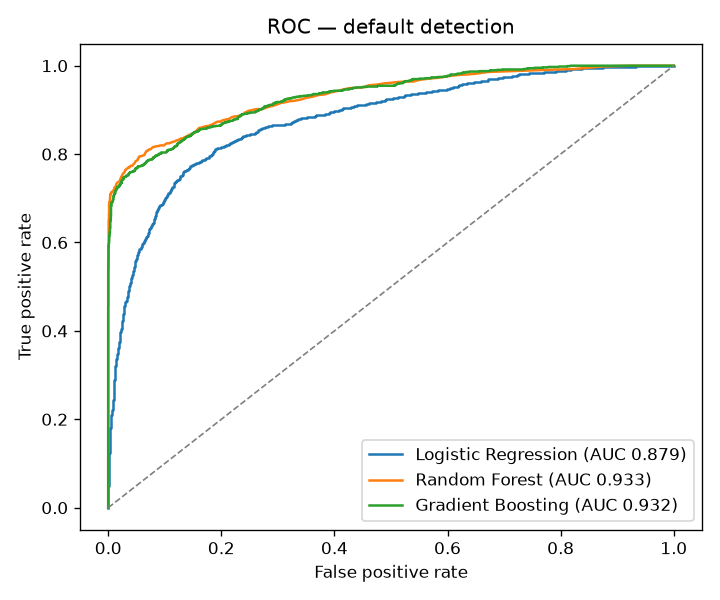
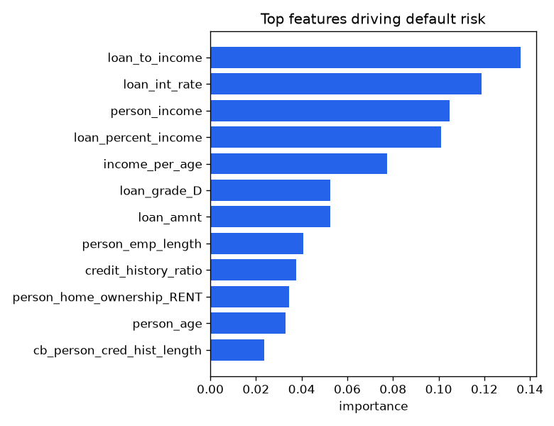
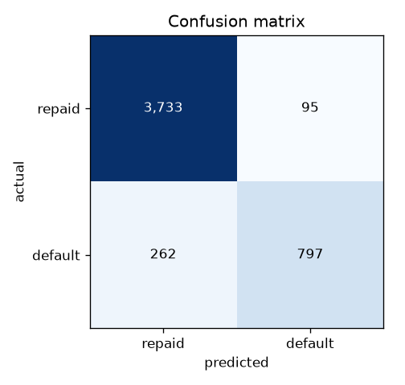

# Loan Default Predictor

Estimate the probability that a loan will default, compare several models, and turn
the best one's predictions into an **approve / review / decline** decision for pending
applicants. Trained on ~24k historical loans.

**→ See [`analysis.ipynb`](./analysis.ipynb) for the full walkthrough with charts.**

## Run

```bash
pip install -r requirements.txt
python loan_default.py      # prints the scorecard, writes charts to reports/
```

## Approach

1. **Feature engineering** — on top of the raw columns, add interpretable ratios a
   credit analyst would look at: `loan_to_income`, `credit_history_ratio`,
   `income_per_age`; cap impossible outliers (employment length > 47 years).
2. **Model comparison** — Logistic Regression vs Random Forest vs Gradient Boosting,
   ranked by **5-fold cross-validated ROC AUC** inside a leakage-safe `Pipeline`.
3. **Evaluation** — full scorecard on a held-out 20% (accuracy, precision, recall,
   F1, ROC AUC).
4. **Scoring** — rank pending applicants and flag each approve / review / decline.

## Results

5-fold CV ROC AUC: **Random Forest 0.929**, Gradient Boosting 0.928, Logistic 0.877.
Held-out test set:

| model | accuracy | precision | recall | F1 | ROC AUC |
|---|---|---|---|---|---|
| Logistic Regression | 82.3% | 56.5% | 78.6% | 65.7% | 0.879 |
| **Random Forest** | **92.7%** | **89.3%** | **75.3%** | **81.7%** | **0.933** |
| Gradient Boosting | 92.8% | 94.5% | 71.1% | 81.1% | 0.932 |

| ROC curves | Feature importance | Confusion matrix |
|---|---|---|
|  |  |  |

The model leans on loan grade, interest rate and the loan-to-income ratio — the same
signals a human underwriter watches.

## Why these metrics

With ~22% defaults the classes are imbalanced, so **ROC AUC and recall** matter more
than raw accuracy: the goal is to catch real defaults (recall) without drowning good
borrowers in false declines. The Random Forest catches ~75% of real defaults while
keeping precision high.

## Data

`data/` holds a public-style credit-risk dataset used purely for demonstration. This
is a learning project, not a production credit model.
