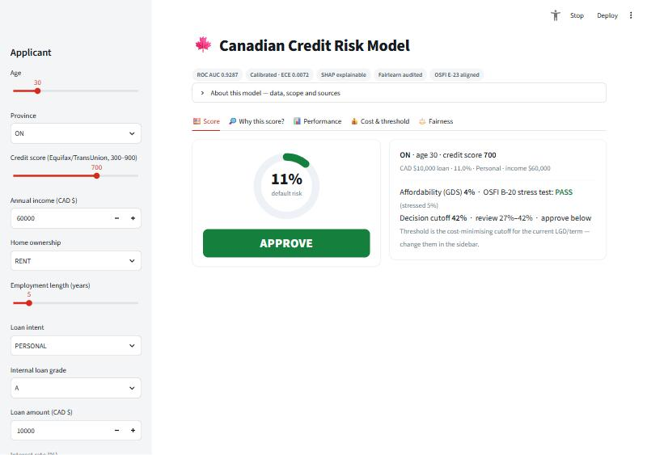
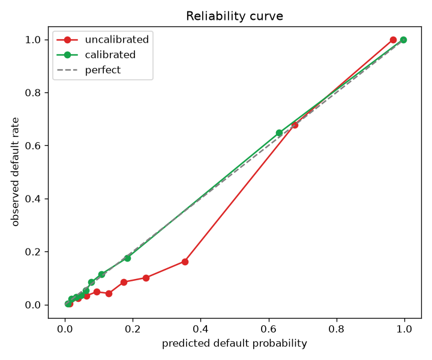
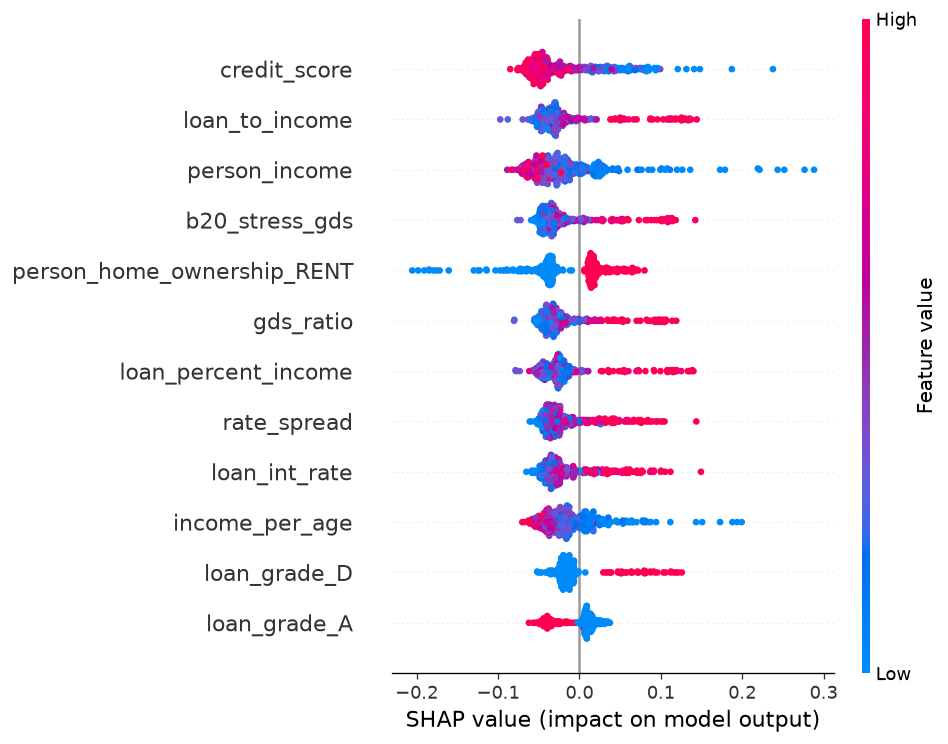
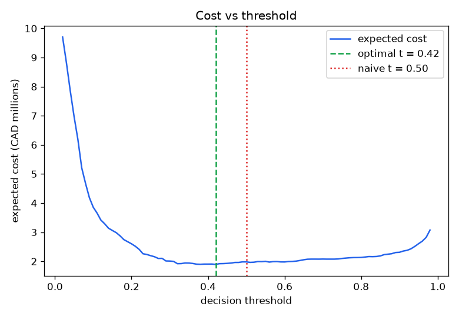
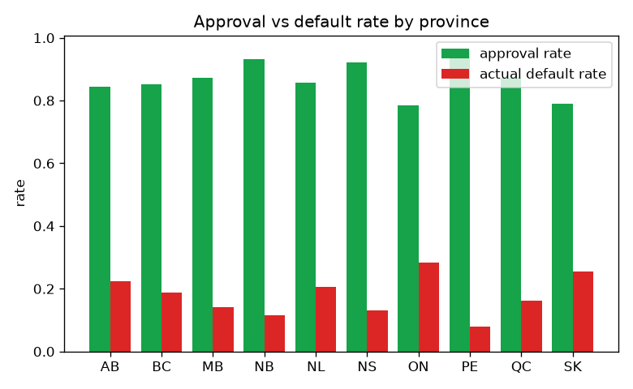

# 🍁 Canadian Credit Risk Model

> A supervised **machine-learning** credit-risk model built for the **Canadian banking**
> context: it predicts loan-default probability in **CAD**, uses an **Equifax/TransUnion
> 300–900 credit score**, and is aligned to **OSFI Guideline E-23** (model risk,
> explainability, fairness) and the **Canadian Human Rights Act**.


**ROC AUC 0.93 · calibrated (ECE 0.006) · explained with SHAP · fairness-audited with Fairlearn.**

**→ [`analysis.ipynb`](./analysis.ipynb) for the walkthrough · `streamlit run app.py` for the demo.**



---

## What it does

Given a Canadian loan application (age, **province**, **credit score 300–900**, income in
CAD, loan details…), the model outputs a **calibrated default probability** and a decision
— **approve / review / decline** — plus the **reasons** behind the score (for an
adverse-action notice). It's trained on ~24,000 loans where the outcome is known.

This is **binary classification**: the model learns the patterns that separate good loans
from bad ones, instead of following hand-written rules.

## Aligned to OSFI Guideline E-23

Canadian federally regulated banks must manage model risk under **OSFI Guideline E-23**
(effective May 2027), which explicitly covers credit-scoring models. Each part of this repo
maps to one of its expectations:

| E-23 expectation | In this project |
|---|---|
| Sound methodology & validation | Cross-validation + held-out test, `train.py` |
| Calibrated, reliable outputs | Isotonic calibration, Brier/ECE — `calibration.py` |
| Explainability | SHAP global + per-applicant reasons — `explain.py` |
| Bias & fairness controls | Fairlearn audit under the Canadian Human Rights Act — `fairness.py` |
| Ongoing monitoring | Population-Stability-Index drift detection — `monitoring.py` |
| Data governance & privacy | Documented provenance; no real personal data (PIPEDA) |

## Canadian underwriting features

Beyond the raw application fields, the model engineers the signals a Canadian lender
actually uses (`loan_default.py`):

- **Affordability** — a gross-debt-service (`gds_ratio`) estimate, and the **OSFI B-20
  stress test**: the borrower is re-qualified at `max(rate + 2%, 5.25%)` and flagged if the
  stressed debt-service exceeds 44%.
- **Regional risk** — `province_delinquency`, each province's real relative 90+ day
  delinquency level (Equifax / CMHC), so Ontario and Saskatchewan carry the higher risk they
  do in reality.
- **Macro** — `rate_spread`, the contract rate over the **Bank of Canada** policy rate.

## Quickstart

```bash
pip install -r requirements.txt
python data/canadianize.py   # build the Canadian-framed dataset
python train.py              # train + calibrate, pick threshold, write model + charts
streamlit run app.py         # interactive demo
```

## Results

Held-out test set (20% never seen in training), calibrated Random Forest:

| metric | value |
|---|---|
| ROC AUC | **0.929** |
| accuracy | 92.6% |
| precision | 94.8% |
| recall | 69.4% |
| F1 | 80.2% |
| Brier score | 0.061 |
| **ECE (calibration error)** | **0.007** |

| ROC curves | Calibration (reliability) | SHAP — feature impact |
|---|---|---|
|  |  |  |

The near-zero ECE means a predicted "20% risk" really does default ~20% of the time — the
probabilities can feed IFRS 9 expected-credit-loss provisioning and risk-based pricing. The
**affordability (B-20 stress / GDS), income and credit score** features carry the most
weight, as a lender would expect. Hyperparameters can be re-tuned with `python tune.py`.

## Cost-based threshold

The two mistakes cost different amounts: approving a loan that defaults loses
`principal × LGD`; declining a good borrower loses the foregone interest. Minimising total
expected cost on the held-out set moves the cutoff to **~0.42**, saving **~$87k CAD** vs the
naive 0.5 — and the demo lets you re-derive it live when LGD/term change.



## Fairness (Canadian Human Rights Act)

Audited with **Fairlearn** (`MetricFrame`, demographic-parity and equalized-odds
differences) across **age** (a protected ground) and **province** (regional access). Because
provincial risk is grounded in real delinquency levels, **Ontario and Saskatchewan show the
lowest approval rates** (ratios ~0.82) and the highest default rates — a genuine regional
pattern. All groups still clear the four-fifths rule (demographic-parity gap 0.06 by age,
0.18 by province), but the audit surfaces where a credit team would look next. The dataset
has **no sex/gender** field, so that protected ground is not audited — stated plainly rather
than faked.



## Model monitoring (E-23 lifecycle)

A model degrades when the population it scores drifts from its training data. `monitoring.py`
computes the **Population Stability Index** per feature — `< 0.10` stable, `0.10–0.25`
moderate, `> 0.25` significant drift that warrants revalidation. The script demonstrates it
catching a simulated rate/income shock (interest-rate PSI jumps past 2.0 → **DRIFT**).

## Repo map

| File | Purpose |
|---|---|
| `loan_default.py` | Data loading, feature engineering, models, scoring (shared core) |
| `data/canadianize.py` | Adds CAD framing, province and a 300–900 credit score |
| `train.py` | Trains + calibrates, picks the threshold, writes `model.joblib` + charts |
| `calibration.py` | Probability calibration (Brier / ECE / reliability curve) |
| `explain.py` | SHAP explainability + per-applicant adverse-action reasons |
| `threshold.py` | Cost-minimising decision threshold |
| `fairness.py` | Fairlearn fairness audit (age + province) |
| `monitoring.py` | Data-drift detection (Population Stability Index) |
| `tune.py` | Hyperparameter search (RandomizedSearchCV) |
| `app.py` | Streamlit demo |
| `analysis.ipynb` | Narrative walkthrough with charts |

## Grounding in real Canadian data

The Canadian signals are built from real public references, cited in code:
[CMHC mortgage-delinquency tables](https://www.cmhc-schl.gc.ca/en/professionals/housing-markets-data-and-research/housing-data/data-tables/mortgage-and-debt)
(relative provincial risk), the [OSFI B-20](https://www.osfi-bsif.gc.ca/en/guidance/guidance-library/residential-mortgage-underwriting-practices-procedures-guideline-b-20)
stress test, [Statistics Canada debt-service data](https://www150.statcan.gc.ca/t1/tbl1/en/tv.action?pid=1010013401)
(GDS/TDS), and the [Bank of Canada](https://www.bankofcanada.ca/rates/) policy rate.

**Still synthetic (next steps):** the per-applicant rows come from an adapted public dataset,
so the exact provincial levels are illustrative relative values, and there is no time axis
for true time-based (out-of-time) validation. Production use would ingest the live CMHC/
StatsCan tables and a dated loan book.

## Data & disclaimer

No open dataset of **individual Canadian loan defaults** exists (privacy / PIPEDA), so this
uses a public US-style credit-risk dataset **adapted to a Canadian framing** — CAD,
provinces sampled from StatsCan population shares, and a derived Equifax/TransUnion-style
300–900 score. It is a **transparent demonstration proxy, not real Canadian bank data**, and
this is a learning project, not a production credit model.

## License

[MIT](./LICENSE)
