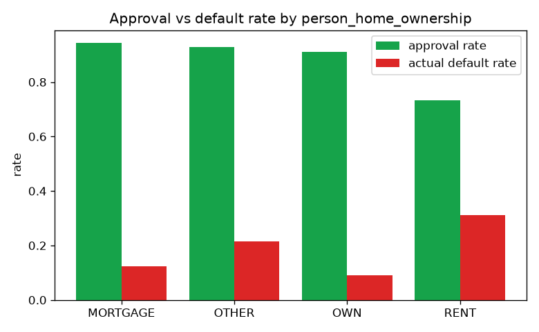

# Loan Default Predictor

Estimate the probability that a loan will default, compare several models, choose the
**cost-optimal** decision threshold, check the model for **fairness**, and score
applicants through an interactive demo. Trained on ~24k historical loans.

**→ [`analysis.ipynb`](./analysis.ipynb) for the walkthrough · `streamlit run app.py` for the demo.**


## Quickstart

```bash
pip install -r requirements.txt
python train.py             # train, pick the threshold, write model + charts
streamlit run app.py        # interactive demo (score applicants, move cost sliders)
```

Other entry points: `python loan_default.py` (scorecard), `python threshold.py`
(cost curve), `python fairness.py` (group audit).

## Approach

1. **Feature engineering** — on top of the raw columns, add interpretable ratios a
   credit analyst would look at: `loan_to_income`, `credit_history_ratio`,
   `income_per_age`; cap impossible outliers.
2. **Model comparison** — Logistic Regression vs Random Forest vs Gradient Boosting,
   ranked by 5-fold cross-validated ROC AUC in a leakage-safe `Pipeline`.
3. **Cost-based threshold** — pick the cutoff that minimises expected money lost, not
   the arbitrary 0.5.
4. **Fairness audit** — check approval parity across age and home-ownership groups.
5. **Interactive demo** — a Streamlit app to score applicants and explore the trade-offs.

## Results

5-fold CV ROC AUC: **Random Forest 0.929**, Gradient Boosting 0.928, Logistic 0.877.
Held-out test set:

| model | accuracy | precision | recall | F1 | ROC AUC |
|---|---|---|---|---|---|
| Logistic Regression | 82.3% | 56.5% | 78.6% | 65.7% | 0.879 |
| **Random Forest** | **92.7%** | **89.1%** | **75.5%** | **81.7%** | **0.933** |
| Gradient Boosting | 92.8% | 94.5% | 71.1% | 81.1% | 0.932 |

| ROC curves | Feature importance | Confusion matrix |
|---|---|---|
|  |  |  |

## Cost-based threshold

A 0.5 cutoff is arbitrary. The two mistakes cost different amounts: approving a loan
that defaults loses `principal × LGD`, while declining a good borrower loses the
interest we would have earned (`principal × rate × term`). Minimising total expected
cost on the held-out set moves the threshold to **0.58**, saving **~$115k** versus 0.5
(at LGD 60%, 3-year term). The demo lets you move those assumptions and watch the
threshold shift.


## Fairness

Lending is regulated (ECOA / Regulation B) against discrimination. The dataset contains
**age** (a protected attribute) and **home ownership** (a wealth proxy); it has **no
race or gender**, so those cannot be audited — stated plainly rather than faked.

Approval parity by the four-fifths rule: **age groups pass** (all within 6% of each
other), but **renters are flagged** — their approval-rate ratio is ~0.78 (< 0.80). That
is driven by a genuinely higher default rate among renters (31% vs ~12% for mortgage
holders), which is exactly the accuracy-vs-fairness tension a real credit team has to
decide how to handle.



## Why these metrics

With ~22% defaults the classes are imbalanced, so **ROC AUC and recall** matter more
than raw accuracy: the goal is to catch real defaults without drowning good borrowers
in false declines.

## Data & disclaimer

`data/` holds a public-style credit-risk dataset used purely for demonstration. This is
a **learning project, not a production credit model** — the fairness screen is a first
look, not a compliance sign-off.
